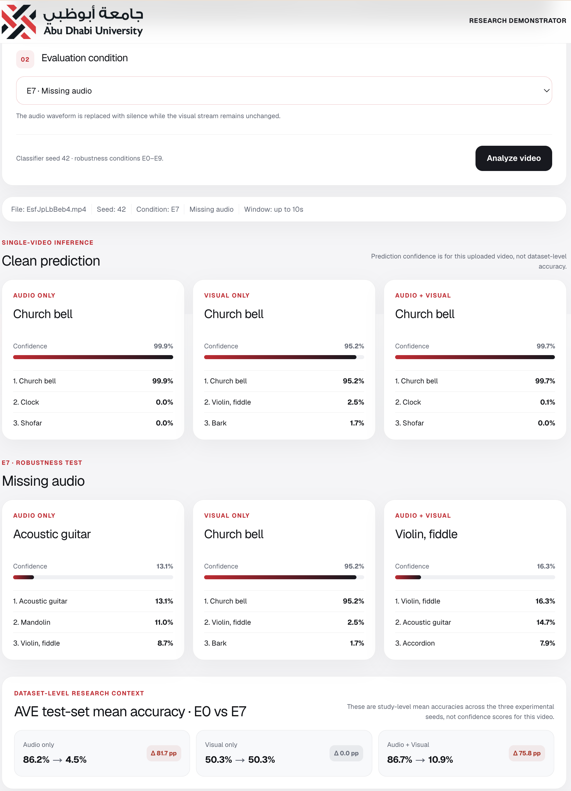

<table align="center">
  <tr>
    <td align="center">

### 🌐 Live Research Demonstrator

**Interactive prototype for multimodal audio-visual robustness evaluation**

<a href="https://multimodal-audio-visual-understandi.vercel.app">
  
</a>

<br>

<sub>Next.js • FastAPI • CLAP • VideoMAE • AVE Dataset</sub>

  </td>
 </tr>
</table>

<br>


# Multimodal Foundation Models for Audio-Visual Understanding

A research project investigating how robust pretrained audio-visual representations are when one modality is noisy, degraded, or missing.
The project evaluates three classification settings on the **Audio-Visual Event (AVE)** dataset:

- **Audio-only** using CLAP
- **Visual-only** using VideoMAE
- **Audio + Visual** using normalized feature fusion and a lightweight MLP classifier

The same preprocessing, corruption, and inference logic is also exposed through an interactive **Next.js + FastAPI research demonstrator**.

---

## Research Question

> How robust are pretrained multimodal foundation models for audio-visual event understanding when audio or visual information is degraded, noisy, or missing?

The study focuses on whether multimodal fusion remains reliable under realistic modality degradation and whether one modality dominates the learned decision process.

---

## Models

### Audio backbone
- Model: `laion/clap-htsat-unfused`
- Sampling rate: 48 kHz
- Frozen encoder
- Embedding size: 512
- L2-normalized before classification

### Visual backbone
- Model: `MCG-NJU/videomae-base`
- 16 uniformly sampled frames
- Frozen encoder
- Mean-pooled embedding size: 768
- L2-normalized before classification

### Multimodal fusion

```text
Audio embedding       512-D
Visual embedding      768-D
                      -----
Multimodal feature   1280-D
```

Each branch uses a lightweight classifier:

```text
Input
  ↓
Linear(input_dim, 256)
  ↓
GELU
  ↓
Dropout(0.30)
  ↓
Linear(256, 28)
  ↓
28 AVE event classes
```

---

## Dataset

This project uses the **Audio-Visual Event (AVE)** dataset.

Validated local manifest:

- Train: 3,339 samples
- Validation: 402 samples
- Test: 402 samples
- Total: 4,143 annotated segments
- Classes: 28
- Unique source videos: 4,097

The dataset itself is **not distributed in this repository**.

See `data/metadata/README.md` for the expected local dataset structure.

---

## Robustness Experiments

All classifiers are trained on clean AVE embeddings and evaluated under the following conditions.

| Experiment | Audio condition | Video condition |
|---|---|---|
| E0 | Clean | Clean |
| E1 | Gaussian noise, 20 dB SNR | Clean |
| E2 | Gaussian noise, 10 dB SNR | Clean |
| E3 | Gaussian noise, 0 dB SNR | Clean |
| E4 | Clean | Gaussian blur, σ = 1 |
| E5 | Clean | Gaussian blur, σ = 2 |
| E6 | Clean | Gaussian blur, σ = 4 |
| E7 | Missing audio | Clean |
| E8 | Clean | Missing video |
| E9 | Gaussian noise, 0 dB SNR | Gaussian blur, σ = 4 |

Three classifier seeds are evaluated: `42`, `43`, and `44`.

Reported metrics include:

- Accuracy
- Macro-F1
- Absolute performance drop
- Performance retention ratio
- Per-class analysis
- Exact McNemar tests with Holm correction

---

## Main Results

Mean test accuracy across seeds:

| Condition | Audio-only | Visual-only | Audio + Visual |
|---|---:|---:|---:|
| E0 Clean | 86.15% | 50.33% | 86.73% |
| E1 Audio 20 dB | 81.84% | 50.33% | 84.08% |
| E2 Audio 10 dB | 75.29% | 50.33% | 78.11% |
| E3 Audio 0 dB | 57.88% | 50.33% | 61.94% |
| E4 Blur σ=1 | 86.15% | 50.17% | 87.06% |
| E5 Blur σ=2 | 86.15% | 41.54% | 86.98% |
| E6 Blur σ=4 | 86.15% | 29.02% | 86.82% |
| E7 Missing audio | 4.48% | 50.33% | 10.95% |
| E8 Missing video | 86.15% | 2.49% | 83.25% |
| E9 Dual degradation | 57.88% | 29.02% | 59.12% |

### Key observation

The evaluated multimodal system is strongly **audio-dominant**.

Severe visual degradation has little effect on multimodal accuracy, while removing audio causes the multimodal classifier to collapse from approximately **86.73% to 10.95%**. By contrast, removing video reduces multimodal accuracy only to approximately **83.25%**.

This indicates that strong clean multimodal performance does not necessarily imply balanced use of both modalities.

These conclusions apply to the evaluated **CLAP + VideoMAE feature-fusion system on AVE** and should not be generalized to all multimodal foundation models.

---

## Source-Disjoint Sensitivity Analysis

The official AVE split contains a small number of repeated source videos across training/validation/test.

A sensitivity analysis was therefore performed on the 394 test samples whose source video does not appear in the training or validation sets.

The main robustness pattern remains consistent:

- clean multimodal performance remains strong
- visual degradation has limited effect on multimodal prediction
- missing audio remains catastrophic
- missing video remains substantially less damaging

This is a **source-disjoint test-subset sensitivity analysis**, not a retrained source-disjoint split.

---

## Interactive Research Demonstrator

The project includes an application built with:

```text
Frontend: Next.js + TypeScript + Tailwind CSS
Backend:  FastAPI + Python
Models:   CLAP + VideoMAE + trained classifier heads
```

The demonstrator lets a user upload a video and compare:

- Audio-only prediction
- Visual-only prediction
- Audio + Visual prediction
- Clean inference
- E0–E9 robustness conditions

The interface deliberately separates **single-video prediction confidence** from **dataset-level research accuracy** so interactive predictions are not confused with experimental test-set metrics.

---
### Example: Missing-Audio Robustness Test

The following example demonstrates experiment **E7 — Missing Audio**.

For the same AVE sample, the clean multimodal model predicts **Church bell** with high confidence. After replacing the audio modality with silence, the audio-only and multimodal predictions collapse, while the visual-only prediction remains stable.



The interactive result is consistent with the dataset-level finding: multimodal mean accuracy decreases from **86.73% under clean conditions to 10.95% when audio is missing**, while the visual-only branch remains unchanged.


---
## Research-Parity Validation

The application was checked against stored research predictions using the same AVE test samples.

Validated paths include:

- E0 clean inference
- E3 0 dB audio noise
- E6 visual blur σ=4
- E7 missing audio
- E8 missing video
- E9 dual degradation

Example AVE sample:

```text
sample_id: ave_03741
video_id:  EsfJpLbBeb4
class:     Church bell
```

For E7, the application reproduces the stored predictions:

```text
Audio-only:      Acoustic guitar
Visual-only:     Church bell
Audio + Visual:  Violin, fiddle
```

For E8:

```text
Audio-only:      Church bell
Visual-only:     Shofar
Audio + Visual:  Church bell
```

Small numerical differences can occur during live model inference due to runtime/backend floating-point behavior, while the preprocessing and corruption procedures remain aligned with the research implementation.

---

## Repository Structure

```text
.
├── app/
│   ├── backend/
│   │   ├── main.py
│   │   ├── inference.py
│   │   └── corruptions.py
│   └── frontend/
│
├── configs/
│   └── models/
│
├── data/
│   └── metadata/
│       └── README.md
│
├── figures/
├── results/
├── src/
│   ├── analysis/
│   ├── data/
│   ├── robustness/
│   └── training/
├── .gitignore
├── README.md
└── requirements.txt
```

Large local assets are intentionally excluded from Git:

```text
data/raw/
data/embeddings/
models/
.venv/
app/frontend/node_modules/
app/frontend/.next/
```

---

## Setup

### 1. Clone the repository

```bash
git clone <YOUR_REPOSITORY_URL>
cd multimodal-audio-visual-understanding
```

### 2. Create a Python environment

Python 3.11 is recommended.

```bash
python3.11 -m venv .venv
source .venv/bin/activate
```

### 3. Install Python dependencies

```bash
pip install -r requirements.txt
```

The project also requires `ffmpeg`.

On macOS with Homebrew:

```bash
brew install ffmpeg
```

---

## Prepare AVE Data

Place AVE videos locally under:

```text
data/raw/ave/videos/
```

Prepare the metadata described in `data/metadata/README.md`.

The validated manifest used by the experiments is expected at:

```text
data/metadata/ave_manifest_validated.csv
```

---

## Run the Backend

From the repository root:

```bash
source .venv/bin/activate
uvicorn app.backend.main:app --reload --port 8000
```

Health endpoint:

```text
http://localhost:8000/health
```

---

## Run the Frontend

Open a second terminal:

```bash
cd app/frontend
npm install
npm run dev
```

Then open:

```text
http://localhost:3000
```

---

## Example API Request

Clean inference:

```bash
curl -s \
-X POST \
-F "condition=E0" \
-F "file=@data/raw/ave/videos/EsfJpLbBeb4.mp4" \
http://localhost:8000/predict \
| python -m json.tool
```

Missing-audio test:

```bash
curl -s \
-X POST \
-F "condition=E7" \
-F "sample_id=ave_03741" \
-F "file=@data/raw/ave/videos/EsfJpLbBeb4.mp4" \
http://localhost:8000/predict \
| python -m json.tool
```

---

## Figures

The project generates research figures for:

1. Clean baseline comparison
2. Audio-noise robustness
3. Video-blur robustness
4. Missing-modality robustness
5. Multimodal performance across all conditions

Generated figures are stored under `figures/`.

---

## Reproducibility

A frozen validated implementation is tagged as:

```text
research-parity-v1
```

To inspect that version:

```bash
git checkout research-parity-v1
```

To return to the current branch:

```bash
git checkout main
```

---

## Research Paper

The accompanying paper is written in IEEE journal style and reports:

- research questions and hypotheses
- related work
- AVE dataset preparation
- CLAP and VideoMAE feature extraction
- unimodal and multimodal baselines
- E0–E9 robustness evaluation
- statistical analysis
- class-level analysis
- source-overlap sensitivity analysis
- interactive research demonstrator
- limitations and future work

---

## Limitations

This study evaluates one feature-level multimodal architecture using frozen CLAP and VideoMAE representations on AVE.

The findings should therefore be interpreted as evidence about this evaluated configuration rather than as a universal property of all multimodal foundation models.

Additional work could investigate:

- alternative fusion strategies
- modality dropout during training
- adaptive modality gating
- confidence-aware fusion
- larger audio-visual datasets
- end-to-end multimodal fine-tuning

---

## Citation

If you use this repository in academic work, cite the accompanying research paper.

```bibtex
@article{multimodal_av_understanding_2026,
  title   = {Multimodal Foundation Models for Audio-Visual Understanding},
  author  = {Author},
  year    = {2026},
  note    = {Course research project}
}
```

Replace the placeholder author information before publication.

---

## Status

Research pipeline: **validated**

Application robustness pipeline: **validated E0–E9**

Paper: **in progress**
